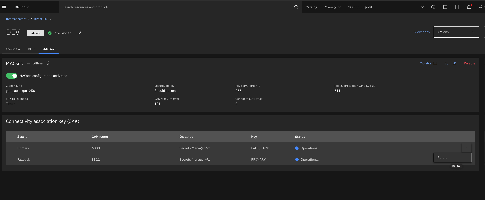

---

copyright:
  years: 2026
lastupdated: "2026-08-13"

keywords: direct link, macsec, dedicated

subcollection: dl

---

{{site.data.keyword.attribute-definition-list}}

# Rotating CAKs for Direct Link Dedicated with MACsec
{: #macsec-cak-rotation}

Rotating keys regularly helps you meet industry standards and cryptographic best practices.
{: shortdesc}

If your CAK material is stored in HPCS, complete your migration to Secrets Manager by 31 December 2026 — the same date new HPCS-based key creation is removed from Direct Link. Because the cutover involves a brief, planned session reset per connection, early scheduling lets you place each change in a normal maintenance window rather than remediating encryption and routing authentication under deadline pressure ahead of the 28 March 2027 deletion deadline.
{: important}

## Key concepts
{: #macsec-cak-rotation-concepts}

- **Primary CAK** – The key both sides use to establish the MACsec session.
- **Fallback CAK** (optional) – A safety net used only if a session cannot be established with the primary CAK.
- **SAK** – The short-lived secure association key, derived from the CAK, that encrypts your traffic. It renews automatically.
- **Secrets Manager or HPCS** – Where your CAK material is stored in IBM Cloud. Direct Link retrieves it securely and programs the IBM side; key material is never sent in the clear.

## Before you begin
{: #macsec-cak-rotation-prereqs}

- Generate the new CAK material securely on-premises.
- Have a Secrets Manager or HPCS instance ready to store it.
- If your device uses a SAK expiration timer, plan to pause it during the rotation.

If your MACsec security policy is set to `must secure`, schedule a maintenance window for the rotation. An unexpected failure to establish a session during rotation can drop frames.
{: important}

## Rotating the primary CAK for Direct Link Dedicated with MACsec
{: #macsec-primary-cak-rotation}

When using Direct Link Dedicated with MACsec, follow these steps to rotate the primary Connectivity Association Key (CAK). This process, if implemented properly, does not result in dropped packets. However, you can configure an optional fallback CAK to take over if there is an unexpected failure to establish a session using the primary CAK.

1. Temporarily disable the Secure Association Key (SAK) expiration timer on your device, if set. This helps avoid SAK renewal failures due to a primary key mismatch on peers during rotation.

   You might have to wait a few minutes before proceeding to the next step. Consult your device manual for details.
   {: note}

1. Configure the new primary CAK name and material on your device. Your device attempts to establish a new MACsec session with the new primary CAK. However, because the peer (IBM device) has not been updated yet, the session remains in `init` state.

   The existing MACsec session is not disrupted and remains secured using the old primary CAK.
   {: note}

1. Store the primary CAK material used in Step 2 in the Secrets Manager or HPCS instance.
1. Update the primary CAK in Direct Link by providing the CAK name and the Secrets Manager or HPCS key CRN containing the material. IBM Direct Link securely retrieves the updated CAK material and configures it with the specified name on the IBM cross-connect switch (XCS) that peers with your device.

   You can complete this step from the console, CLI, or API:
   - **Console**: Open your Direct Link Dedicated instance, select the **MACsec** tab, find the key in the **Connectivity association key (CAK)** table, and select **Rotate** from the Actions menu.

   {: caption="Example: Rotating CAK in the IBM Cloud console" caption-side="bottom"}

   - **CLI**: Update the gateway's CAK using the `ibmcloud dl` command, passing the new CAK name and the Secrets Manager or HPCS key CRN.
   - **API**: Send a PATCH request to the gateway's MACsec CAK resource with the CAK name and the key CRN.

1. Wait for the new MACsec session to be established with the new key.

   You might have to wait a few minutes after a session is established before proceeding to the next step. Consult your device manual for details.
   {: note}

1. Delete the old primary CAK from your device. If using the SAK expiration timer, re-enable it on your device.

   IBM does the same on the XCS.
   {: note}

IBM actions corresponding to steps in this procedure are triggered when you update the primary CAK.

## Rotating the fallback CAK for Direct Link Dedicated with MACsec
{: #macsec-fallback-cak-rotation}

Use of a fallback CAK is optional. If you configure a fallback CAK, you might need to rotate it periodically as well. To avoid dropped frames, it is recommended to rotate the fallback CAK only when a MACsec session is established with the primary CAK. Because the fallback CAK is used only if a session cannot be established using the primary CAK, the process to rotate the fallback CAK is simpler.

   This procedure assumes that a new fallback CAK material is securely generated on-premises.
   {: important}

1. Delete the old fallback CAK and configure the new fallback CAK name and material on your device.
1. Store the fallback CAK material used in Step 1 in the Secrets Manager or HPCS instance.
1. Rotate the fallback CAK in Direct Link from the console, CLI, or API, providing the CAK name and the key CRN. IBM Direct Link securely retrieves the new CAK and configures it on the XCS that peers with your device.

## Related resources
{: #macsec-cak-rotation-related}

- [Direct Link HPCS Key Migration](https://community.ibm.com/community/user/blogs/nick-woodyard/2026/08/13/directlinkkeymigration){: external} — IBM Cloud Networking blog post with a step-by-step walkthrough of zero-downtime CAK rotation for Direct Link Dedicated with MACsec.
